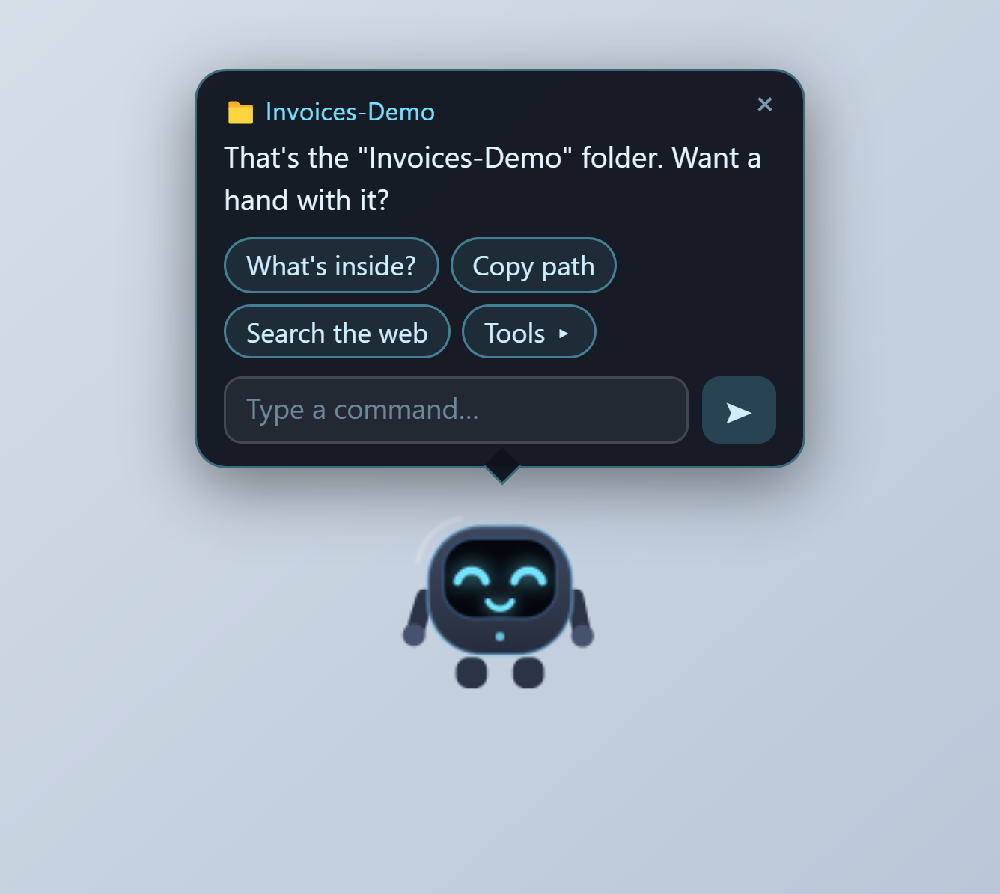
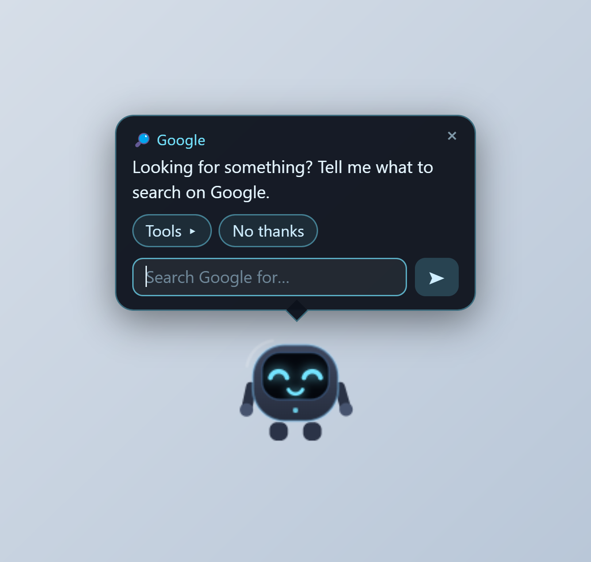
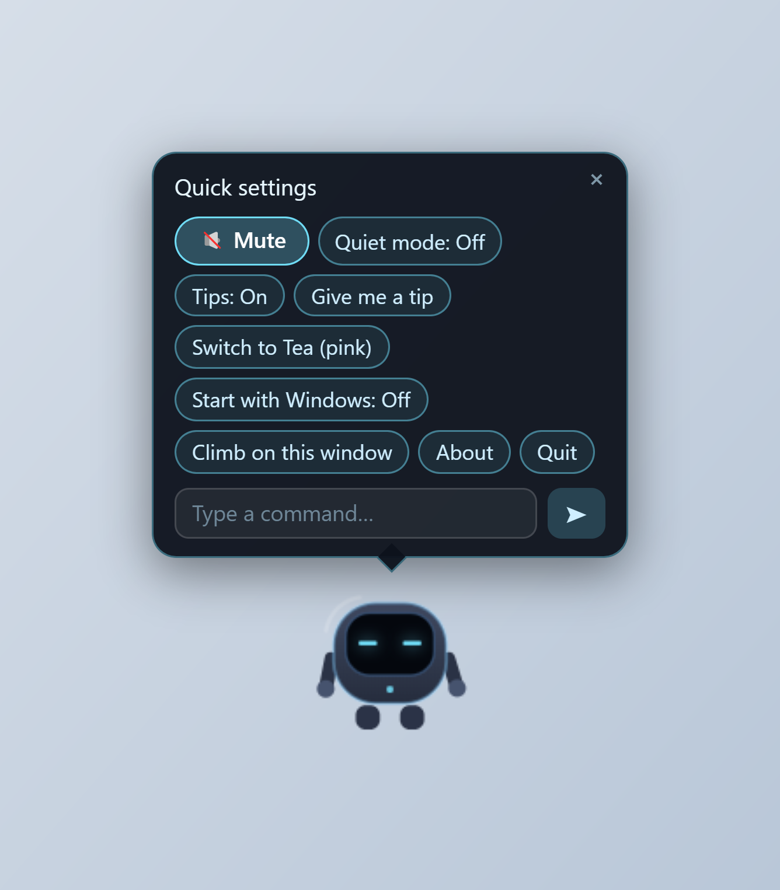
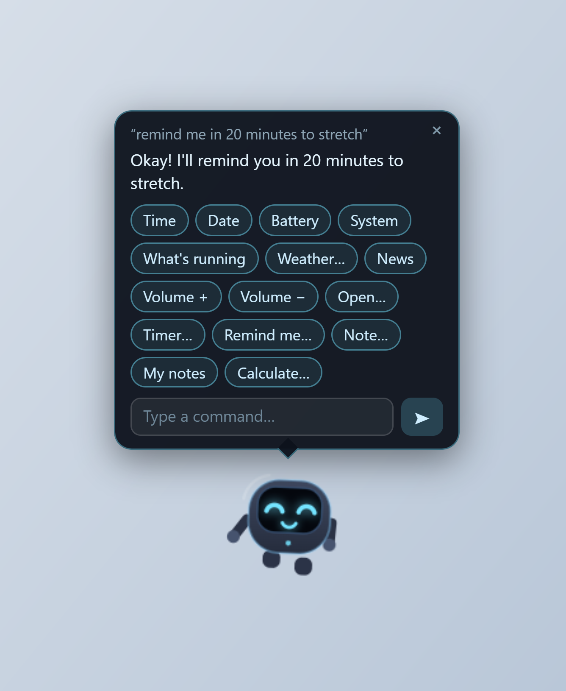
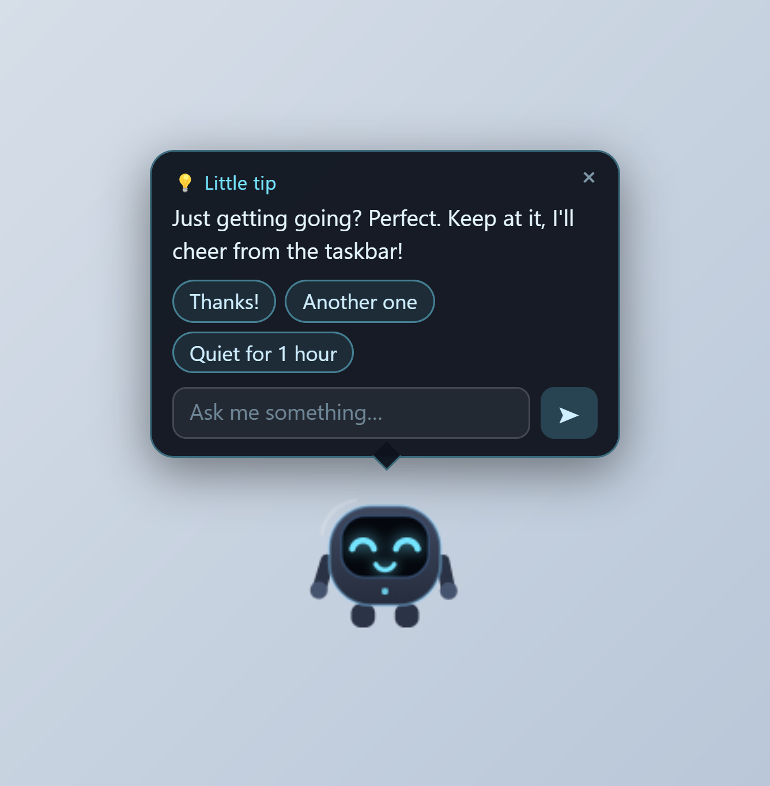
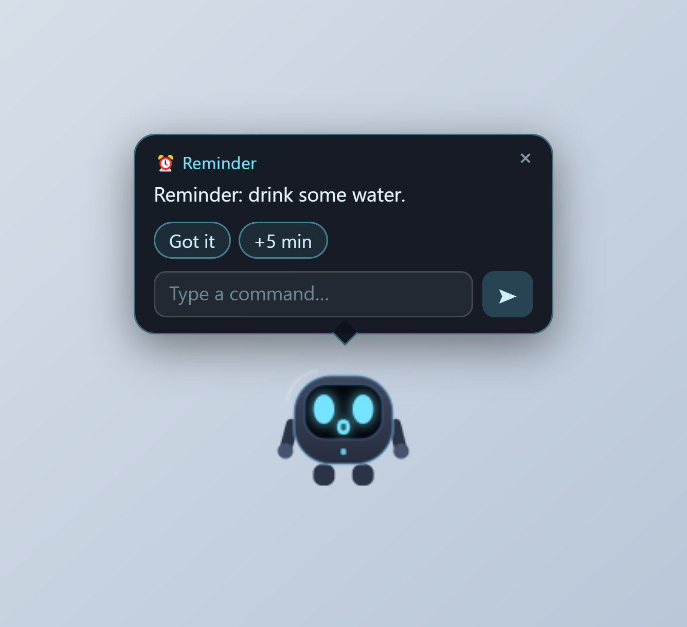

# Teo — Desktop Buddy

🌐 **[English](README.md)** · [Italiano](translations/README.it.md) · [Français](translations/README.fr.md) · [Español](translations/README.es.md) · [Deutsch](translations/README.de.md) · [हिन्दी](translations/README.hi.md)

**A tiny desk robot who lives on your Windows taskbar.**
Meet **Teo**: he hops when you click him, climbs up onto the windows and folders
you open, pops up a speech bubble with quick actions, and answers **instantly**,
**out loud**, in a real voice — and when the job is done, he goes quietly back home.

> **No account. No subscription. No language model. No cloud.**
> Every feature, no limits, nothing locked — it even works without any AI subscription.

---

### Highlights

- 🤖 **A little character, not a window** — Teo blinks, looks around, wanders, falls asleep when you leave him alone, and wears real expressions.
- 🧗 **He climbs your windows** — open a window or a folder and he walks over, jumps, climbs the side and perches on the top edge (riding along if you drag it).
- ✋ **Pick him up and drop him anywhere** — on empty desktop he falls back to the taskbar; on a window's side edge he grabs the wall and climbs; over a window he hops onto its top.
- 💬 **A speech bubble that goes away by itself** — quick actions for what you just opened (*What's inside?*, *Copy path*, *Search the web*) plus a mini chat; when the task ends, the bubble ends.
- 🔎 **He knows where he is** — open Google or YouTube and Teo hops onto the search box and asks what you want to find.
- 💡 **Friendly little tips** — drink water, stand up, rest your eyes, "you just started, keep going!" — funny, spoken, and never when you're watching a video.
- ⏰ **A pocket assistant** — `timer 10 min`, `remind me at 15:30 to leave`, `note buy milk`, `15% of 80` — all local, all free.
- 🎙️ **A real voice, on your PC** — a proper on-device neural voice (English), choose voice on/off at launch.
- 🪶 **Small and quiet** — no language model, no huge download, no background service.

---

### Screenshots

<table>
<tr>
<td width="50%">

**A folder opens** — Teo climbs up and offers a hand.

</td>
<td width="50%">

**He knows the page** — hops onto Google's search box and asks what to search.

</td>
</tr>
<tr>
<td width="50%">

**Quick settings** — right-click Teo. Quiet mode, voice, tips…

</td>
<td width="50%">

**Pocket assistant** — timers, reminders, notes and math, typed in the bubble.

</td>
</tr>
<tr>
<td width="50%">

**Little tips** — a friendly nudge when you leave him resting.

</td>
<td width="50%">

**Reminders ring** — out loud, with a bubble, even in Quiet mode.

</td>
</tr>
</table>

---

### Download & install

1. Open the [**Releases**](../../releases/latest) page and download
   `Teo-Setup-<version>.exe`.
2. Run it. The installer is **per-user** — it needs **no administrator rights**.
3. Teo walks in along the taskbar and says hello.

> **Only one file to download.** Each release also lists `latest.yml` and a
> `.blockmap` file — those aren't for you, they're metadata Teo himself reads
> in the background to check for and install updates automatically. The
> `.exe` is the only thing you ever need to grab by hand.

> **First launch:** the installer isn't code-signed, so Windows SmartScreen may
> show *"Windows protected your PC"*. Click **More info → Run anyway**. This is
> normal for a free, independent app.

New here? The [**Welcome guide**](WELCOME.md) walks through setup and your
first minutes with nothing assumed.

**No other setup needed** — there is no model to install first. The very first
spoken reply downloads a small voice model (a few hundred MB, once); everything
after that is instant and fully offline.

---

### Documentation

| Document | What it covers |
|---|---|
| [Welcome guide](WELCOME.md) | Beginner, step-by-step: install, meet Teo, your first minutes |
| [Guide](GUIDE.md) | Everything Teo does and every command you can type |
| [Privacy](PRIVACY.md) | Exactly what does (and doesn't) touch the network |
| [License](LICENSE) | Free to use — full terms |
| [Third-party notices](THIRD-PARTY-NOTICES.md) | Open-source components Teo is built with |

---

### System requirements

| | Minimum |
|---|---|
| **OS** | Windows 10 / 11, 64-bit |
| **RAM** | 4 GB |
| **Free disk** | ~600 MB (app + voice model) |
| **Internet** | For the one-time voice download, the update check, and the Weather / News / web-search lookups only |

Everything else — windows, folders, tips, timers, notes, math, the voice itself — works fully offline.

---

### Privacy at a glance

- **No accounts, no API keys, no telemetry, no analytics.**
- **No language model runs anywhere** — every action is a small, fixed routine.
- The voice runs **on your PC**, after a one-time download.
- Teo only looks at each window's **title, type, program name and position** (and a folder's path) to know where to climb — never what's inside a window, never what you type.
- Teo **updates himself** — he checks GitHub quietly in the background and installs new versions on his own.
- The only network use, ever: the one-time voice download, the update check, and the lookups you explicitly ask for (**Weather**, **News**, **web search**).

Full detail: [PRIVACY.md](PRIVACY.md).

---

### License

Free to use — but this is a licence, not open source: no redistribution,
no reselling, no modification. Every copy has every feature, with no usage limits.
See the full terms in [LICENSE](LICENSE).

*Not affiliated with, sponsored by, or associated with any film, game,
franchise, or brand. "Teo" is simply a friendly name.*
